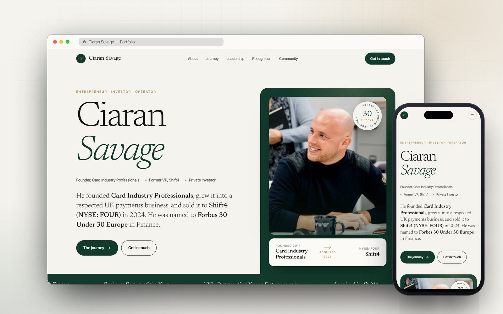
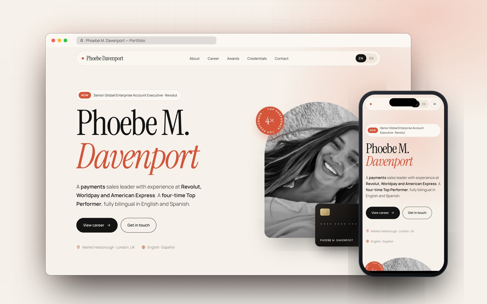
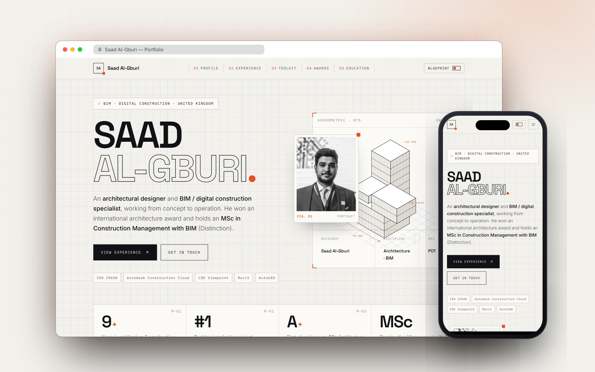
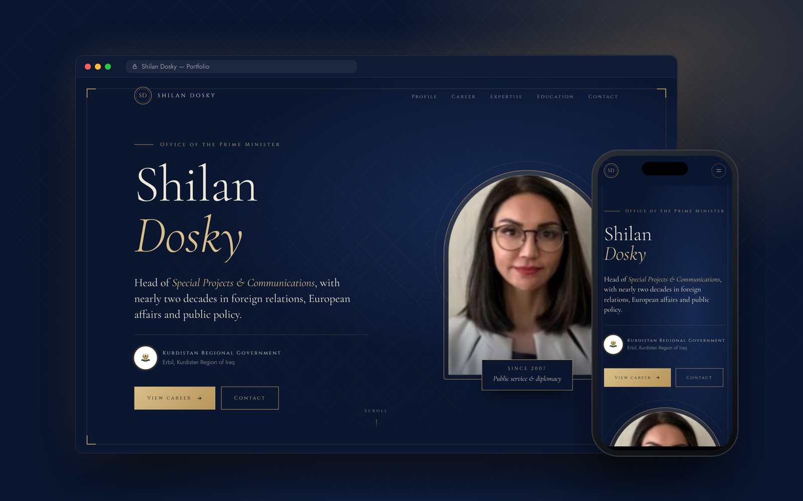
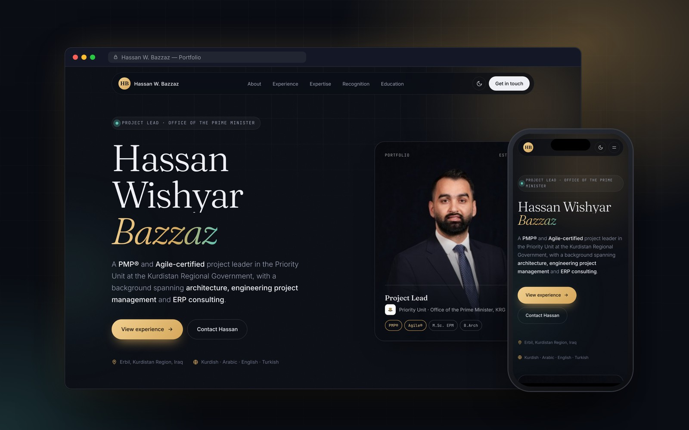

# Client Portfolios

Personal portfolio websites designed and built by **Essential Studios**.

Each portfolio is a fast, self-contained static site: a single `index.html` with its favicon set and web manifest. No build step and no dependencies.

## Portfolios

| Preview | Client | Role | Live site |
|---|---|---|---|
|  | **Ciaran Savage** | Entrepreneur & Investor | — |
|  | **Phoebe M. Davenport** | Senior Global Enterprise Account Executive | [phebe.site](https://phebe.site) |
|  | **Saad Al-Gburi** | Architectural Designer & BIM Specialist | [saad-raad.com](https://saad-raad.com) |
|  | **Shilan Dosky** | Head of Special Projects & Communications | — |
|  | **Hassan Wishyar Bazzaz** | Project Lead | — |

## Repository layout

```
sites/<client-name>/     The live website files (deployed as-is)
  index.html
  favicon.svg, favicon.ico, favicon-32.png
  apple-touch-icon.png, icon-192.png, icon-512.png
  site.webmanifest
previews/<client-name>.jpg   Project thumbnail (1600×1000)
_starter/                    Starting point for a new portfolio
sites.json                   Folder → client → domain list
```

## How publishing works

Every folder in `sites/` is automatically copied to its own branch, `deploy/<client-name>`, whenever `main` changes (see `.github/workflows/publish.yml`).

Each Hostinger website is connected to its branch with auto-deploy, so **pushing to `main` updates the live site** within a minute or two.

See [PUBLISHING.md](PUBLISHING.md) for the step-by-step checklist for adding a new client.

---

© Essential Studios. Website enquiries: fathima@essential-studios.com
